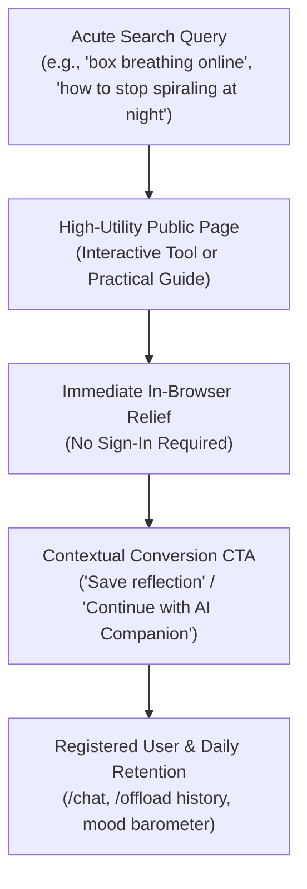

# 10. SEO Architecture, Technical Gap Audit & Positioning Strategy

**Document Version:** 1.0.0  
**Target Domain:** [heyrewire.com](https://heyrewire.com)  
**Primary Application Stack:** Next.js 16 (App Router), Tailwind CSS v4, Headless WordPress (`/guides`), TypeScript  
**Audience:** Technical Architects, Engineering Leads, Product Managers, SEO Specialists  

---

## 1. Executive Summary & Search Positioning Framework

### 1.1 The Core Positioning Wedge
Most mental health and mindfulness apps position around saturated, high-barrier head terms (*"meditation app"*, *"mental health app"*, *"therapy"*), directly competing against venture-backed category kings (Calm, Headspace, BetterHelp) and medical publisher monopolies (Healthline, Verywell Mind).

**HeyRewire’s defensible search positioning is: "Active Cognitive Untangling."**

```
   Passive Meditation (Calm / Headspace)          Active Cognitive Untangling (HeyRewire)
 ┌────────────────────────────────────────┐     ┌────────────────────────────────────────┐
 │ • Sit quietly in silence               │ vs. │ • Externalize racing thoughts (Canvas) │
 │ • Often amplifies racing loops         │     │ • Challenge distortions (CBT Reframing)│
 │ • Passive audio consumption            │     │ • Tactile, interactive box breathing   │
 └────────────────────────────────────────┘     └────────────────────────────────────────┘
```

### 1.2 User Intent & Acquisition Funnel
Searchers experiencing acute mental distress or overthinking do not search for software; they search for **relief in the moment**.



---

## 2. Technical SEO Gap Audit & Vulnerability Log

### 2.1 Critical Severity (Blockers & De-indexing Risks)

| Issue ID | File / Location | Issue Description | Impact | Architectural Resolution |
| :--- | :--- | :--- | :--- | :--- |
| **SEO-BUG-01** | `apps/web/app/guides/page.tsx` (L33) | `alternates.canonical: "/buides"` | Canonical points to a 404 URL. Google drops or misindexes the blog directory. | Correct canonical string to `"/guides"`. |
| **SEO-BUG-02** | `apps/web/app/guides/[slug]/page.tsx` (L81, L87) | `canonical: "/blog/${post.slug}"` | Post canonical points to `/blog/...` but routes are mounted at `/guides/...`. All individual articles point to non-existent URLs. | Update metadata canonical and Open Graph URL to `"/guides/${post.slug}"`. |
| **SEO-BUG-03** | `apps/web/app/layout.tsx` (L145-L180) | `FAQPage` Schema Invisible in DOM | JSON-LD specifies 4 FAQ entities, but the questions and answers do not appear visibly on `app/page.tsx`. Google explicitly penalizes hidden schema. | Either render a visible, accessible `<FAQSection />` on the homepage or scope `FAQPage` schema only to pages where FAQs are rendered. |

### 2.2 High Severity (SERP Truncation & E-E-A-T Compliance)

| Issue ID | File / Location | Issue Description | Impact | Architectural Resolution |
| :--- | :--- | :--- | :--- | :--- |
| **SEO-GAP-04** | `apps/web/app/layout.tsx` (L26-L28) | Meta description length is 197 characters (ideal is 145–155 chars). | Snippets are truncated mid-sentence on both desktop and mobile SERPs. | Rewrite concise, action-oriented description with high-CTR verbs. |
| **SEO-GAP-05** | `apps/web/app/layout.tsx` (L137-L141) | Personal Gmail and mobile phone number in `Organization` schema. | For YMYL (health) queries, personal email addresses lower algorithmic institutional trust. | Switch to official domain alias (`support@heyrewire.com`). |
| **SEO-GAP-06** | `apps/web/app/page.tsx` (L68-L73) | Primary `<h1>` tag lacks core search keywords: *"Break Overthinking Loops With an Empathetic Companion"*. | Low semantic relevance for primary transactional/problem queries. | Update `<h1>` to weave in high-intent keyword phrases: *"Stop Overthinking & Calm Racing Thoughts"*. |
| **SEO-GAP-07** | `apps/web/app/page.tsx` (L1) | Root landing page is `"use client"`. | Disables per-page `export const metadata`. Metadata is tightly coupled to `layout.tsx`. | Separate interactive client widgets (`BreathingWidget`, `MoodBarometer`) into isolated client leaf components; keep `app/page.tsx` as a Server Component. |

---

## 3. High-Value Keyword Matrix for Technical Planning

This matrix dictates which routes, landing pages, and content modules engineering must prioritize.

### Cluster 1: Public Interactive Utility Pages (Highest Conversion & Backlink Potential)

| Target Keyword | Monthly Search Volume (Global) | Keyword Difficulty | Search Intent | Target Architecture Route | Required Page Features |
| :--- | :--- | :--- | :--- | :--- | :--- |
| `box breathing online` | 49,500 | Low - Medium | Practical / Tool | `/tools/box-breathing` | Fullscreen interactive SVG box animation, 4-4-4-4 rhythm selector, ambient sound toggle, schema `WebApplication`. |
| `cbt thought record online` | 14,800 | Low | Solution / Tool | `/tools/thought-reframer` | 3-step micro-canvas (Situation $\rightarrow$ Automatic Distortion $\rightarrow$ Rational Reframe). CTA to save to `/offload`. |
| `digital brain dump template` | 12,100 | Low | Solution / Tool | `/tools/brain-dump` (or canonical `/offload`) | Markdown-friendly thought canvas, "burn/dissolve" visual ritual, emotion tagging. |
| `4 7 8 breathing technique timer` | 33,000 | Low - Medium | Practical / Tool | `/tools/4-7-8-breathing` | Configurable breathing cadences, dark mode default for nighttime panic. |

### Cluster 2: Acute Problem & Nocturnal Rumination (High-Pain Intent)

| Target Keyword | Monthly Search Volume (Global) | Keyword Difficulty | Search Intent | Target Architecture Route | Content Strategy |
| :--- | :--- | :--- | :--- | :--- | :--- |
| `how to stop overthinking at night` | 22,200 | Medium | Informational / Acute | `/guides/how-to-stop-overthinking-at-night` | Embed the interactive box breathing widget directly in the post body. Include actionable 5-step night offload protocol. |
| `racing thoughts can't sleep` | 14,800 | Medium | Informational / Acute | `/guides/racing-thoughts-before-sleep` | Distinguish physiological arousal vs cognitive loops. Direct funnel to private Brain Dump canvas. |
| `how to calm down spiraling thoughts` | 9,900 | Low - Medium | Informational / Immediate | `/guides/how-to-calm-spiraling-thoughts` | Cognitive grounding techniques (5-4-3-2-1 sensory method, box breathing, decatastrophizing questions). |

### Cluster 3: Cognitive Distortion Frameworks (Topical Authority Engine)

| Target Keyword | Monthly Search Volume (Global) | Keyword Difficulty | Search Intent | Target Architecture Route | Content Strategy |
| :--- | :--- | :--- | :--- | :--- | :--- |
| `cognitive distortions list cbt` | 27,100 | Medium - High | Educational / Hub | `/guides/cognitive-distortions-list` | Cornerstone hub page defining the 10 core distortions with clickable interactive reframe cards. |
| `catastrophizing examples and how to stop` | 12,000 | Low - Medium | Educational / Practical | `/guides/catastrophizing-examples-how-to-stop` | De-catastrophizing worksheet logic, worst-case vs realistic-case analysis. |
| `all or nothing thinking examples` | 8,100 | Low | Educational / Practical | `/guides/all-or-nothing-thinking-cbt` | Spectrum thinking exercise, nuanced middle-ground journaling prompts. |

### Cluster 4: Competitor Intercept & Comparison Queries

| Target Keyword | Monthly Search Volume (Global) | Keyword Difficulty | Search Intent | Target Architecture Route | Positioning Strategy |
| :--- | :--- | :--- | :--- | :--- | :--- |
| `why meditation makes anxiety worse` | 4,400 | Low | Problem Resolution | `/guides/why-meditation-makes-anxiety-worse` | Explains relaxation-induced anxiety (RIA). Positions active CBT journaling as the structured, safer alternative. |
| `best cbt apps for overthinking` | 2,900 | Medium | Commercial Investigation | `/guides/best-cbt-apps-for-overthinking` | Transparent comparison matrix comparing Woebot, Bloom, stoic., and HeyRewire (highlighting web accessibility and privacy). |
| `woebot alternatives` | 1,600 | Low | Commercial Investigation | `/guides/woebot-alternatives` | Highlights HeyRewire's consumer-friendly, non-enterprise approach with flexible thought offloading. |

---

## 4. Architectural Implementation Blueprint

### 4.1 Recommended Information Architecture (Sitemap Map)

```
heyrewire.com
├── / (Homepage: Core Value Prop + Live Barometer + Visible FAQ)
├── /tools/
│   ├── /box-breathing (Standalone Fullscreen Utility)
│   ├── /thought-reframer (Interactive Micro-CBT Tool)
│   └── /brain-dump (Public uninhibited offloading canvas)
├── /offload (Authenticated Personal Sanctuary & Journal History)
├── /guides/ (Headless WordPress Blog Engine)
│   ├── /cognitive-distortions-list (Pillar Hub)
│   └── /[slug] (Spoke Guides with embedded widgets)
├── /crisis-resources (Multi-Regional Verified Directory - Crucial for E-E-A-T)
└── /about, /privacy, /terms, /disclaimer (Institutional Trust Pages)
```

### 4.2 Metadata & JSON-LD Structured Data Schema Architecture

```
                                  Page Types & Schemas
 ┌──────────────────────┬────────────────────────┬────────────────────────┬──────────────────────┐
 │ Homepage (/)         │ Tool Pages (/tools/*)  │ Guide Pages (/guides/*)│ Directory Pages      │
 ├──────────────────────┼────────────────────────┼────────────────────────┼──────────────────────┤
 │ • WebSite            │ • WebApplication       │ • Article / BlogPosting│ • MedicalWebPage     │
 │ • Organization       │ • SoftwareApplication  │ • BreadcrumbList       │ • ContactPoint       │
 │ • FAQPage (Visible!) │ • HowTo (optional)     │ • Person (Author)      │                      │
 └──────────────────────┴────────────────────────┴────────────────────────┴──────────────────────┘
```

#### Code Specification: Updated Homepage Metadata (`apps/web/app/layout.tsx` / `page.tsx`)
```typescript
export const metadata: Metadata = {
  metadataBase: new URL("https://heyrewire.com"),
  title: {
    default: "Stop Overthinking & Calm Racing Thoughts | HeyRewire",
    template: "%s | HeyRewire",
  },
  description:
    "Quiet racing thoughts, untangle anxiety, and reframe worries with CBT-informed journaling, interactive box breathing, and a private reflection companion.",
  keywords: [
    "stop overthinking",
    "how to stop overthinking at night",
    "calm racing thoughts",
    "cbt thought record",
    "brain dump journal",
    "box breathing online",
    "cognitive reframing exercises",
  ],
  alternates: {
    canonical: "/",
  },
  openGraph: {
    type: "website",
    locale: "en_US",
    url: "https://heyrewire.com",
    siteName: "HeyRewire",
    title: "Stop Overthinking & Calm Racing Thoughts | HeyRewire",
    description:
      "Break rumination spirals with CBT-informed journaling, interactive box breathing, and an empathetic private companion.",
    images: [
      {
        url: "/og-image.png",
        width: 1200,
        height: 630,
        alt: "HeyRewire Mental Health Companion",
      },
    ],
  },
};
```

#### Code Specification: Dynamic Canonical Tag Pattern for Guides (`apps/web/app/guides/[slug]/page.tsx`)
```typescript
export async function generateMetadata({ params }: BlogPostPageProps): Promise<Metadata> {
  const { slug } = await params;
  const post = await getWordPressPostBySlug(slug);

  if (!post) return { title: "Article Not Found" };

  const cleanTitle = decodeHtmlEntities(post.title.rendered);
  const cleanExcerpt = decodeHtmlEntities(stripHtml(post.excerpt.rendered || "")).slice(0, 155);

  return {
    title: cleanTitle,
    description: cleanExcerpt,
    alternates: {
      canonical: `/guides/${post.slug}`, // Fixed: Points to /guides, NOT /blog
    },
    openGraph: {
      type: "article",
      title: cleanTitle,
      description: cleanExcerpt,
      url: `https://heyrewire.com/guides/${post.slug}`,
      publishedTime: post.date,
      modifiedTime: post.modified,
    },
  };
}
```

---

## 5. Engineering Roadmap & Sprint Execution Plan

### Sprint 1: Critical Bug Remediation & Baseline Compliance (Completed)
* [x] **Fix canonical routes:**
  * Patched `apps/web/app/guides/page.tsx` (`/buides` $\rightarrow$ `/guides`).
  * Patched `apps/web/app/guides/[slug]/page.tsx` (`/blog/${post.slug}` $\rightarrow$ `/guides/${post.slug}`).
  * Patched `apps/web/app/sitemap.ts` (`/blog/${post.slug}` $\rightarrow$ `/guides/${post.slug}`).
* [x] **Fix Homepage Metadata & Snippet:**
  * Shortened meta description to 152 characters (`layout.tsx` & `page.tsx`).
  * Updated `<title>` to target *"Stop Overthinking & Calm Racing Thoughts | HeyRewire"*.
  * Updated `<h1>` to weave in high-intent keyword phrases.
* [x] **Harmonize FAQ Schema & DOM:**
  * Built accessible accordion `<FAQSection />` on `apps/web/app/page.tsx` matching the 4 FAQ entities in `layout.tsx`.
  * Scoped `FAQPage` JSON-LD schema to the homepage DOM where the questions are visibly rendered.
* [x] **Sanitize E-E-A-T Data:**
  * Replaced personal Gmail and phone in `Organization` schema and footer with official support domain alias (`support@heyrewire.com`).
* [x] **Convert Root Page to Server Component (SEO-GAP-07):**
  * Converted `apps/web/app/page.tsx` to a Server Component for raw HTML crawlability.
  * Isolated client leaf widgets (`HeroActions`, `HomeCrisisBanner`, `BreathingWidget`).

### Sprint 2: Programmatic Free Tools Architecture (Completed)
* [x] **Extract Standalone `/tools/box-breathing` Route:**
  * Decoupled breathing exercise into dedicated full-screen page with pattern switching (4-4-4-4, 4-7-8, Calm 4-6).
  * Added custom SEO metadata, rich instructional copy on the 4-4-4-4 method, and `WebApplication` & `HowTo` schema.
* [x] **Build `/tools/thought-reframer` Micro-Tool:**
  * Built client-side, 3-step cognitive reframing interface (Situation $\rightarrow$ Distortion $\rightarrow$ Reframe).
  * Allowed anonymous users to test reframing with copy and save CTA to `/offload`.
  * Added `WebApplication` & `HowTo` schema and educational cognitive distortion matrix.
* [x] **Configure XML Sitemap Dynamic Generation:**
  * Updated `apps/web/app/sitemap.ts` to include `/tools/box-breathing` and `/tools/thought-reframer`.
  * Fixed WordPress guide route paths to `/guides/${post.slug}`.
  * Set authentic dynamic `lastModified` timestamps.

### Sprint 3: Topical Authority & Internal Linking Silos (Ranking Scaler)
* [ ] **Publish the "Cognitive Distortions" Pillar:**
  * Develop the definitive 10-part cognitive distortion interactive guide.
* [ ] **Widget Embedding Pipeline in Guides:**
  * Implement an inline shortcode or MDX/React-Markdown transformer to embed the interactive breathing circle and thought reframer directly inside WordPress guides.
* [ ] **Setup Google Search Console (GSC) Monitoring:**
  * Submit corrected sitemap index (`heyrewire.com/sitemap.xml`).
  * Monitor Index Coverage and fix any Soft 404 or Alternate Page with Proper Canonical Tag warnings.
